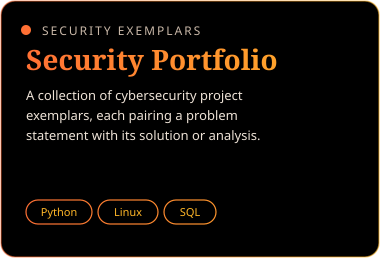
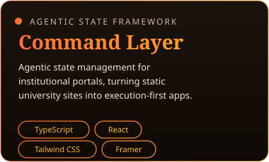
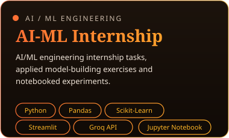
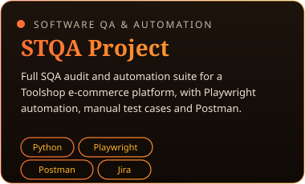

  

 

 

<table width="100%">
<tr>
<td width="55%" valign="top">

**Role:** AI &amp; Full-Stack Engineer  
**Location:** Layyah, Punjab, Pakistan (Open to Global Remote)  
**Education:** BS Information Technology, University of Layyah (2023 - 2027)  
**Academic Standing:** CGPA 3.94 / 4.00  
**Recognition:** WONTX AI University Selection (PYIIC 2026) · SOFTEC'26 Competitor (Incept Bionic)

</td>
<td width="45%" valign="top">

Final-year BS IT scholar specializing in applied AI/LLM systems, full-stack web engineering, and zero-trust cybersecurity. Independently building end-to-end RAG frameworks, multi-LLM evaluation benchmarks, reinforcement-learning biometric agents, and assistive computer vision applications.

</td>
</tr>
</table>

 

 

<table width="100%">
<tr>
<th align="left" width="25%">Domain</th>
<th align="left">Stack</th>
</tr>
<tr>
<td valign="top"><strong>AI, LLMs &amp; Machine Learning</strong></td>
<td>Multi-LLM Evaluation · RAG Pipelines · Reinforcement Learning (Q-Learning) · Prompt Engineering · NLP (BERT, TF-IDF) · PyTorch · Scikit-Learn · NumPy · Pandas · OpenCV</td>
</tr>
<tr>
<td valign="top"><strong>Full-Stack &amp; Mobile</strong></td>
<td>Python · TypeScript · JavaScript (ES6+) · C++ · FastAPI · React · Node.js · Express.js · React Native (Expo) · HTML5 / CSS3 · Tailwind CSS · REST APIs</td>
</tr>
<tr>
<td valign="top"><strong>Databases &amp; Security</strong></td>
<td>PostgreSQL · MongoDB · SQLite · Oracle SQL · OWASP Top 10 (JWT, RBAC, CSRF) · Behavioral Biometrics · NIDS · Wireshark · Clerk Auth · Linux · Git / GitHub · Vercel</td>
</tr>
</table>

 

 

 

<table width="100%">
<tr>
<th align="left" width="22%">Project</th>
<th align="left" width="46%">Summary</th>
<th align="left">Stack</th>
</tr>
<tr>
<td valign="top"><strong><a href="https://github.com/dreams-from-dust/AI_model_wontx">WONTX AI</a></strong> Zero-Trust Behavioral Biometrics</td>
<td valign="top">Autonomous Q-Learning desktop agent profiling real-time keystroke dwell/flight times and mouse velocity/jitter to auto-lock workstations upon intruder detection. Selected from the University of Layyah for the Punjab Youth Innovation &amp; Incubation Competition 2026.</td>
<td valign="top">Python · Q-Learning · Pynput · NumPy · Pandas · CustomTkinter</td>
</tr>
<tr>
<td valign="top"><strong><a href="https://github.com/dreams-from-dust/ai-grading-gap">AI Grading Gap</a></strong> Empirical Multi-LLM Benchmark</td>
<td valign="top">Open-source Python benchmark evaluating multi-LLM grading reliability (Llama, Qwen, Claude) against human grades across essays and short answers using QWK, Pearson r, MAE, variance dispersion ratios, and trained gap-prediction models.</td>
<td valign="top">Python · Scikit-Learn · Pandas · NumPy · LLM Evaluation · EDA</td>
</tr>
<tr>
<td valign="top"><strong><a href="https://github.com/dreams-from-dust/groundlink-ai">GroundLink AI</a></strong> Agentic RAG Grounding Pipeline</td>
<td valign="top">Retrieval-Augmented Generation framework grounding LLM reasoning in verified web and document sources with automated citation checks to reduce hallucinations (<a href="https://groundlink-ai.vercel.app/">Live Demo</a>).</td>
<td valign="top">Python · FastAPI · LangChain · RAG · Groq API · React · TypeScript</td>
</tr>
<tr>
<td valign="top"><strong><a href="https://github.com/dreams-from-dust/incept-bionic">Incept Bionic</a></strong> SOFTEC'26 Accessibility Platform</td>
<td valign="top">Real-time computer vision object detection and speech-to-text audio guidance platform for sensory-impaired users, showcased at SOFTEC'26 FAST NUCES Lahore (<a href="https://incept-bionic.vercel.app/">Live Demo</a>).</td>
<td valign="top">Node.js · Express.js · MongoDB · WebSockets · AI Inference APIs</td>
</tr>
<tr>
<td valign="top"><strong><a href="https://github.com/dreams-from-dust/TunePrompt-Project">TunePrompt</a></strong> Cross-Platform Prompt App</td>
<td valign="top">Cross-platform mobile app translating rough concepts into structured, domain-tuned AI prompts for video editors and SEO specialists with secure auth and low-latency LLM inference.</td>
<td valign="top">React Native (Expo) · TypeScript · Expo Router · Clerk Auth · Groq API (Llama 3)</td>
</tr>
</table>

 

<strong>MORE PROJECTS</strong>

    

 

 

  <table width="100%">
    <thead>
      <tr>
        <th align="center" width="8%">#</th>
        <th align="left" width="62%">Credential</th>
        <th align="left" width="30%">Issuer</th>
      </tr>
    </thead>
    <tbody>
      <tr><td align="center">1</td><td>Google AI Professional Certificate (7-Course Series)</td><td>Google / Coursera</td></tr>
      <tr><td align="center">2</td><td>Google Cybersecurity Professional Certificate (8-Course Series)</td><td>Google / Coursera</td></tr>
      <tr><td align="center">3</td><td>Building AI Applications with AWS Bedrock</td><td>AWS Student Builder Group, UoL</td></tr>
      <tr><td align="center">4</td><td>Outstanding Achievement in AWS Student Builder Group</td><td>AWS Student Builder Group, UoL</td></tr>
      <tr><td align="center">5</td><td>Cybersecurity Job Simulation</td><td>Mastercard (Forage)</td></tr>
      <tr><td align="center">6</td><td>AI for App Building &amp; AI for Data Analysis</td><td>Google / Coursera</td></tr>
      <tr><td align="center">7</td><td>AI for Research, Insights, Content &amp; Communication</td><td>Google / Coursera</td></tr>
      <tr><td align="center">8</td><td>AI Fundamentals &amp; Accelerate Your Job Search with AI</td><td>Google / Coursera</td></tr>
      <tr><td align="center">9</td><td>Automate Cybersecurity Tasks with Python</td><td>Google / Coursera</td></tr>
      <tr><td align="center">10</td><td>Connect &amp; Protect: Networks and Network Security</td><td>Google / Coursera</td></tr>
      <tr><td align="center">11</td><td>Sound the Alarm: Detection and Response</td><td>Google / Coursera</td></tr>
      <tr><td align="center">12</td><td>Tools of the Trade: Linux and SQL</td><td>Google / Coursera</td></tr>
      <tr><td align="center">13</td><td>Assets, Threats, and Vulnerabilities</td><td>Google / Coursera</td></tr>
      <tr><td align="center">14</td><td>Advanced Commands in Linux &amp; Linux Filesystem</td><td>Coursera Project Network</td></tr>
      <tr><td align="center">15</td><td>14-Day AI Boot Camp</td><td>Futurepedia Skill Leap AI</td></tr>
      <tr><td align="center">16</td><td>SEO &amp; Freelancing Certificates</td><td>DigiSkills.pk, Ministry of IT</td></tr>
      <tr><td align="center">17</td><td>SOFTEC'26 Software Project Competition</td><td>FAST NUCES Lahore</td></tr>
    </tbody>
  </table>

 

 

 

  

  

  

 

  
&nbsp;&nbsp;&nbsp;&nbsp;&nbsp;&nbsp;&nbsp;&nbsp;&nbsp;&nbsp;&nbsp;&nbsp;&nbsp;&nbsp;&nbsp;&nbsp;&nbsp;&nbsp;&nbsp;&nbsp;&nbsp;&nbsp;&nbsp;&nbsp;

  

